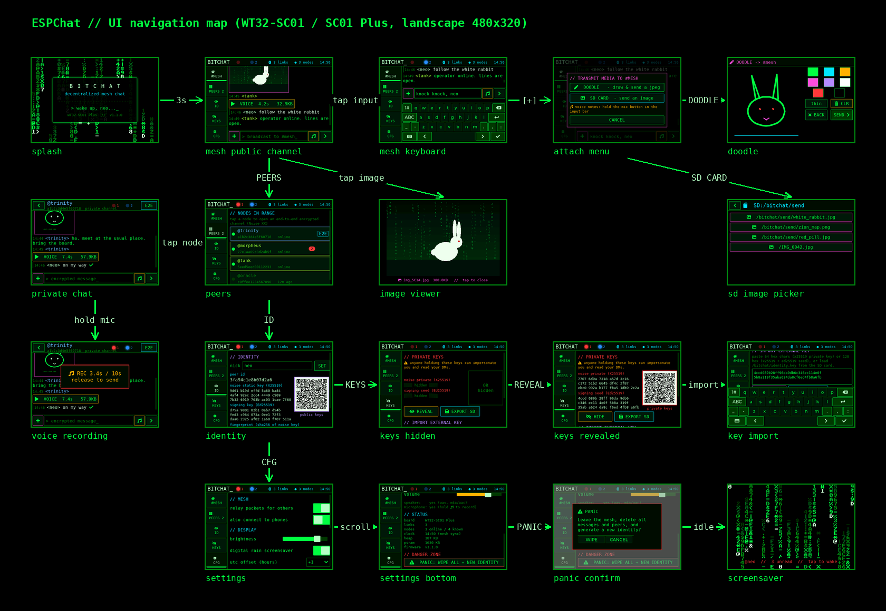

# ESPChat — bitchat client for WT32‑SC01 / WT32‑SC01 Plus

A standalone [bitchat](https://github.com/permissionlesstech/bitchat) mesh messenger
for the WT32‑SC01 (ESP32) and WT32‑SC01 Plus (ESP32‑S3) 3.5" touch displays. It uses
PlatformIO, Arduino, LVGL 8.3 and NimBLE, with a dark, matrix‑style landscape UI.



## Features

- **Public #mesh channel.** Messages are signed with Ed25519 and verified against the
  sender's announced key. Unverified senders are marked `?`.
- **Private messages.** End‑to‑end encrypted with `Noise_XX_25519_ChaChaPoly_SHA256`.
  You get delivered (✓✓) and read (👁) receipts.
- **Images, both directions.**
  - Receive JPEG and PNG, shown as thumbnails with a full‑screen viewer. Progressive
    JPEGs are not supported.
  - Send by drawing on the on‑device doodle pad (encoded to JPEG), or by picking a
    file from the SD card (Plus).
- **Voice notes.**
  - Playback of bitchat `.m4a` (AAC, through a built‑in MP4 demuxer and the Helix
    decoder) and `.wav`.
  - Recording to 8 kHz WAV if an I2S MEMS mic is fitted.
  - On the Plus, sound plays through the on‑board NS4168 speaker amp.
- **Mesh node.**
  - BLE peripheral: phones running bitchat connect to the board, as with the T‑Deck client. It
    advertises the bitchat UUID at +18 dBm on the Plus. The central role, where the board also
    connects to phones, is optional: CFG → "also connect to phones", off by default.
  - Fragmentation and reassembly, TTL relaying with de‑duplication, raw‑DEFLATE
    decompression.
  - The clock syncs from peers' announces (there is no RTC).
- **Identity.**
  - The ID page shows your peer id, fingerprint, and both public keys in hex with a
    QR code.
  - The KEYS page shows the private keys (hidden until you tap REVEAL) in hex and as a
    QR code. You can export them to SD, or import an external key by pasting hex or
    loading `/bitchat/identity.key`.
  - PANIC wipes everything and creates a new identity.
- **UI.**
  - Landscape 480×320 with a sidebar: `#MESH · PEERS · ID · KEYS · CFG`.
  - Green base colour with cyan, amber, magenta and violet accents. Each nick gets its
    own colour.
  - DejaVu Sans Mono font.
  - Two blinking virtual LEDs in the header: **red** for unread #mesh messages, **blue** for
    unread private messages, each with a counter.
  - Digital‑rain splash screen and screensaver.

## Documentation

The full GitHub Pages documentation is in [`docs/`](docs/index.md), including setup, user guide, hardware, development, protocol notes, limitations, and refreshed screenshots. To publish it, configure GitHub Pages to build from the `/docs` folder on the default branch.

All pages are also listed in [`screenshots/README.md`](screenshots/README.md).

## Hardware

| | WT32‑SC01 | WT32‑SC01 Plus |
|---|---|---|
| MCU | ESP32 (WROVER, PSRAM) | ESP32‑S3, 16 MB flash, 2 MB PSRAM |
| Display | ST7796 320×480, SPI | ST7796 320×480, 8‑bit parallel |
| Touch | FT6336U | FT6336U |
| Speaker | – (an I2S DAC can be wired) | NS4168 I2S amp |
| SD | – | yes |
| Mic | optional external I2S (INMP441) | optional external I2S (INMP441) |

Pins and features are set in [`include/board_config.h`](include/board_config.h).

- To enable a microphone, build with `-DHAS_MIC=1` and set `I2S_MIC_*`.
- To flip the screen by 180°, use `-DLCD_ROTATION=3`.

## Build and flash

```sh
pio run -e wt32-sc01-plus -t upload     # ESP32-S3 Plus
pio run -e wt32-sc01      -t upload     # original SC01
pio device monitor
```

## Debug logs

The serial log only shows real errors by default. For per-connection logs (connections, GATT
discovery, announces) and a mesh summary every 10 s, build with `-DCORE_DEBUG_LEVEL=4`.

## Tests and tools

| Command | What it does |
|---|---|
| `tools/host_test/run.sh` | Interop test. Runs the firmware's Noise / packet / TLV code against an independent Python implementation (`cryptography`): handshake in both roles, transport framing and replay rejection, Ed25519 packet signatures, raw‑DEFLATE, announce and file TLVs. |
| `tools/screenshots/build.sh` | Renders every UI page on the PC (headless LVGL) into `screenshots/`. |
| `tools/fonts/gen_font.py` | Regenerates the monospace fonts. |

## Protocol notes (bitchat compatibility)

- **BLE.** Service `F47B5E2D-4A9E-4C5A-9B3F-8E1D2C3A4B5C`. Characteristic
  `A1B2C3D4-E5F6-4A5B-8C9D-0E1F2A3B4C5D` (write, write‑without‑response, notify).
- **Packet.**
  - Header: v1 is 14 bytes, v2 is 16 bytes (32‑bit length). Then sender (8),
    recipient (8, optional), route (v2), payload, and an Ed25519 signature (64,
    optional).
  - Padding is PKCS#7‑style to blocks of 256, 512, 1024 or 2048 bytes.
  - The signature covers the padded encoding with `ttl = 0`.
- **Peer id.** The first 8 bytes of SHA‑256 of the Noise static key.
- **Announce.** TLVs: nickname, Noise key, signing key, capabilities.
- **Noise transport frame.** `[u32 BE nonce][ciphertext][tag]`. Inner payload types:
  `0x01` message, `0x02` read, `0x03` delivered, `0x20` file.
- **Fragments.** Type `0x20`, with an 8‑byte id, u16 index and u16 total.
- **Files.** `BitchatFilePacket` TLV. Public files use type `0x22` (v2, signed).
  Private files go inside Noise as `0x20`.

## Known limitations

- **Untested against real devices.** The protocol was implemented from the bitchat
  sources and checked against the host interop test, not yet against iOS or Android.
  The details most worth checking first are:
  - padding rules per message type
  - announce signature acceptance
  - private‑media fragment limits
- **Voice notes recorded here are 8‑bit WAV, not m4a.** The ESP32 has no AAC encoder.
  Phones should play WAV, but bitchat may show it as a generic audio file. Recordings
  are capped at 10 s so private transfers stay under 256 fragments.
- **Unsupported features:** Nostr/geohash channels, the gossip sync (`requestSync`),
  and live push‑to‑talk voice frames. These packets are ignored and relayed.
- **Public text is sent in chunks of ≤ 96 bytes, and the announce stays ≤ 99 bytes.** Receivers re-encode
  a packet to check its signature and compress payloads of 100 bytes or more, which would break it. For
  the same reason, public voice notes in WAV (very compressible) may fail signature verification on the
  phones. Private ones (inside Noise) are not affected.
- **The clock starts from the build time (UTC)** and syncs from the first announce received. The apps
  drop packets with very wrong timestamps.
- **Messages are not persisted across reboots.** The identity and settings are, in NVS.
- **Connection limit.** BLE allows 3 connections on the SC01 and 4 on the Plus, shared
  between both roles.
