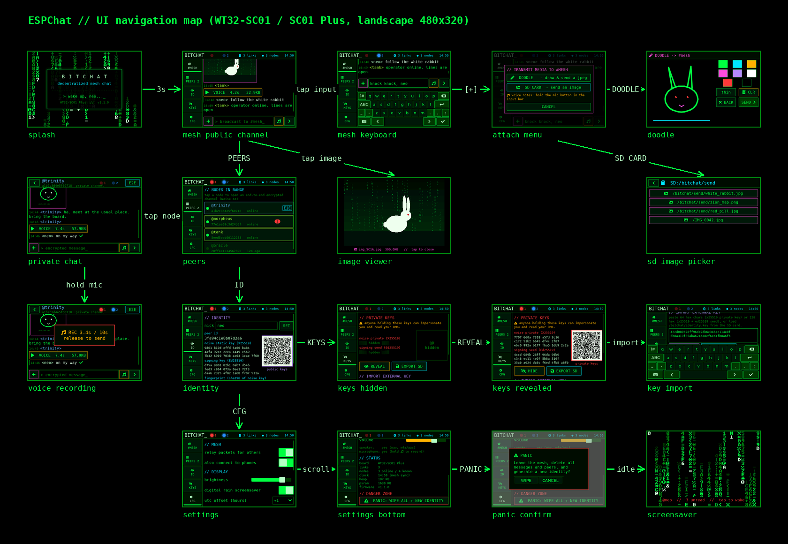

WT32-SC01 · WT32-SC01 Plus

# ESPChat

A standalone [bitchat](https://github.com/permissionlesstech/bitchat) compatible mesh messenger for the WT32-SC01 and WT32-SC01 Plus touch displays.

ESPChat connects over Bluetooth Low Energy (BLE), relays mesh packets, and provides public chat, encrypted private messages, image sharing, voice notes, and identity tools in a compact 480 × 320 landscape interface.

<nav class="site-nav">
  <a href="getting-started">Get started</a>
  <a href="user-guide">User guide</a>
  <a href="hardware">Hardware</a>
  <a href="development">Development</a>
  <a href="protocol">Protocol</a>
  <a href="screenshots">Screenshots</a>
</nav>

## What it does

- Broadcast signed messages in the public `#mesh` channel.
- Establish end-to-end encrypted private conversations using Noise XX.
- Send and receive images, voice notes, and files over the mesh.
- Relay and reassemble fragmented packets from nearby nodes.
- Show peers, identity fingerprints, public keys, and private key management on device.
- Run on either WT32-SC01 board, with additional SD and audio support on the Plus.

## Read the docs

| Page | Contents |
|---|---|
| [Get started](getting-started) | Requirements, build, flash, and first launch |
| [User guide](user-guide) | Navigation, messaging, media, identity, and settings |
| [Hardware](hardware) | Board differences, optional wiring, and configuration |
| [Development](development) | Project layout, build commands, screenshot tool, and host interop check |
| [Protocol](protocol) | BLE service, packet format, encryption, signatures, and media |
| [Screenshots](screenshots) | Refreshed reference images for all UI pages |
| [Limitations](limitations) | Compatibility status and known constraints |

## Project status

ESPChat is a community project. The firmware's protocol implementation has a host-side interoperability check, but has not yet been validated against the official iOS and Android apps. See [limitations](limitations) before relying on compatibility or media transfer.

The UI screenshots on this site are generated from the firmware's LVGL code using a headless desktop renderer and representative demo data. They are refreshed from the source with `tools/screenshots/build.sh`.
