# Screenshots

<nav class="site-nav"><a href="index">Home</a><a href="user-guide">User guide</a><a href="development">How to regenerate</a></nav>

Every image below is rendered from the firmware's LVGL interface and theme using the headless desktop screenshot tool. Images were refreshed from the current source with `tooassets/screenshots/build.sh`. They show representative demo data, not a live device connection.

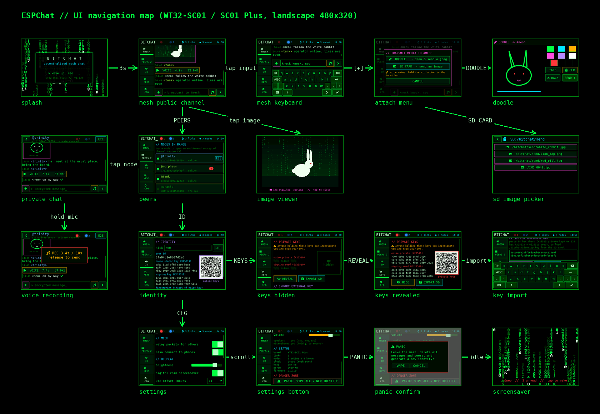

<figure><a href="assets/screenshots/01_splash.png">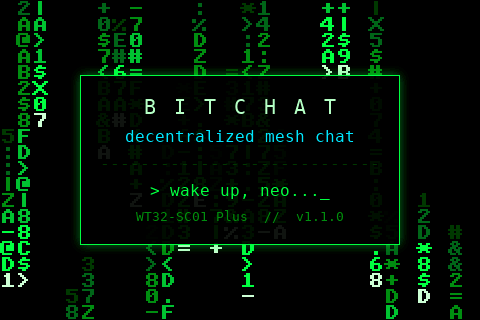</a><figcaption>01 · Splash screen</figcaption></figure>
<figure><a href="assets/screenshots/02_mesh_public_channel.png">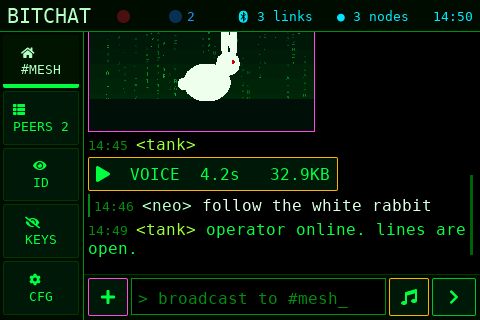</a><figcaption>02 · Public #MESH channel</figcaption></figure>
<figure><a href="assets/screenshots/03_mesh_keyboard.png">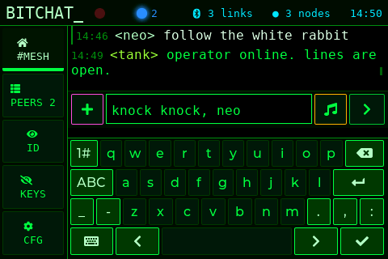</a><figcaption>03 · On-screen keyboard</figcaption></figure>
<figure><a href="assets/screenshots/04_attach_menu.png">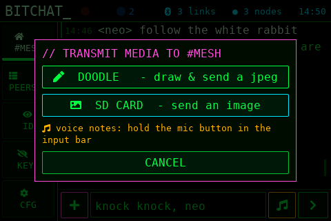</a><figcaption>04 · Attach menu</figcaption></figure>
<figure><a href="assets/screenshots/05_doodle.png">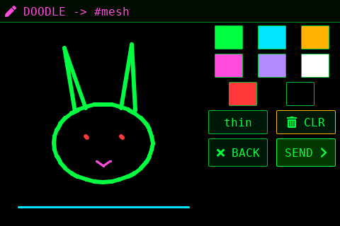</a><figcaption>05 · Doodle pad</figcaption></figure>
<figure><a href="assets/screenshots/06_image_viewer.png">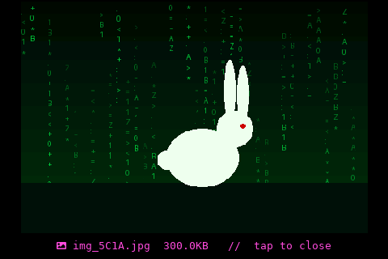</a><figcaption>06 · Image viewer</figcaption></figure>
<figure><a href="assets/screenshots/07_peers.png">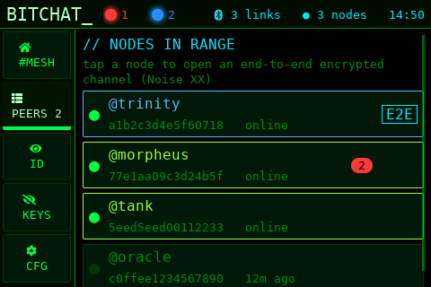</a><figcaption>07 · Peers</figcaption></figure>
<figure><a href="assets/screenshots/08_private_chat.png">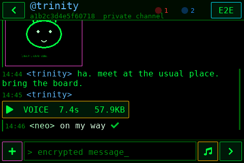</a><figcaption>08 · Private chat</figcaption></figure>
<figure><a href="assets/screenshots/09_voice_recording.png">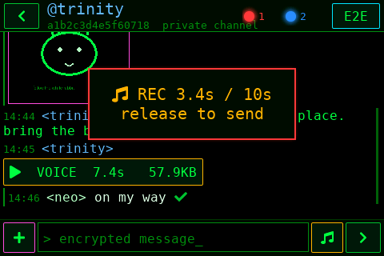</a><figcaption>09 · Voice recording</figcaption></figure>
<figure><a href="assets/screenshots/10_sd_image_picker.png">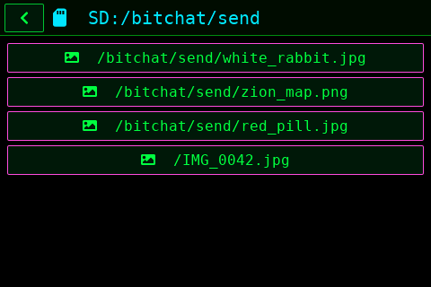</a><figcaption>10 · SD image picker</figcaption></figure>
<figure><a href="assets/screenshots/11_identity.png">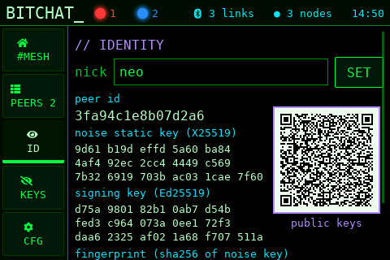</a><figcaption>11 · Identity</figcaption></figure>
<figure><a href="assets/screenshots/12_keys_hidden.png">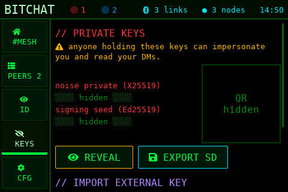</a><figcaption>12 · Private keys hidden</figcaption></figure>
<figure><a href="assets/screenshots/13_keys_revealed.png">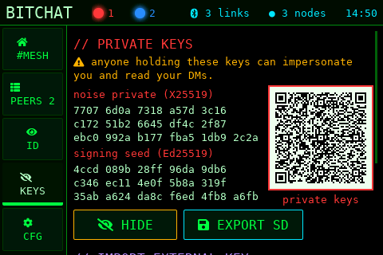</a><figcaption>13 · Private keys revealed</figcaption></figure>
<figure><a href="assets/screenshots/14_key_import.png">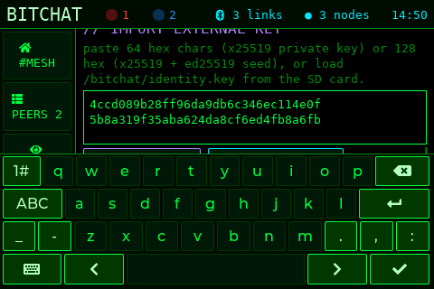</a><figcaption>14 · Key import</figcaption></figure>
<figure><a href="assets/screenshots/15_settings.png">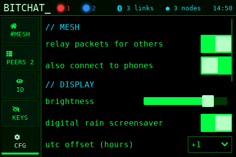</a><figcaption>15 · Settings</figcaption></figure>
<figure><a href="assets/screenshots/16_settings_bottom.png">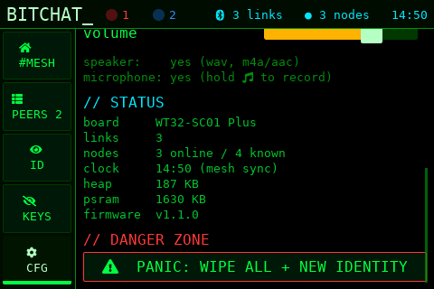</a><figcaption>16 · Settings, lower section</figcaption></figure>
<figure><a href="assets/screenshots/17_panic_confirm.png">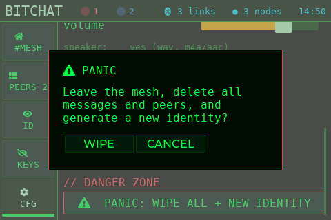</a><figcaption>17 · Panic confirmation</figcaption></figure>
<figure><a href="assets/screenshots/18_screensaver.png">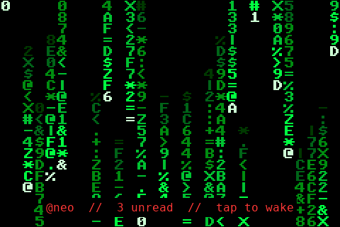</a><figcaption>18 · Screensaver</figcaption></figure>

