# Screenshots

Every page of the UI, rendered from the **real firmware UI code** (LVGL 8.3, same theme and
fonts) by a headless PC build with demo data. These were refreshed from the current firmware
source with `tools/screenshots/build.sh`. The GitHub Pages gallery is in [`docs/screenshots.md`](../docs/screenshots.md).

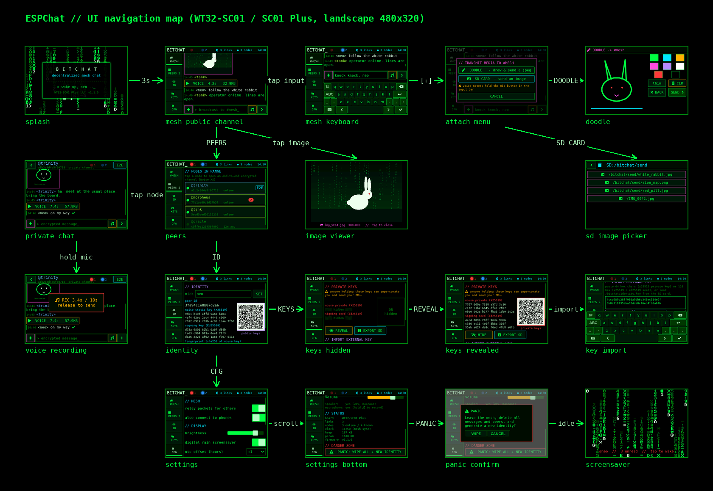

| # | Page | How to get there |
|---|------|------------------|
| 01 | 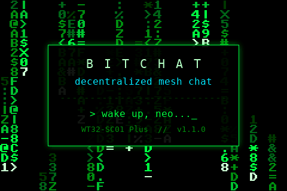 splash | boot (digital rain, 3 s) |
| 02 | 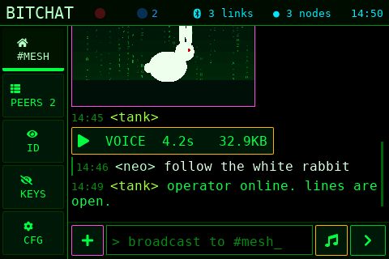 #MESH public channel | default page; Ed25519‑signed broadcast |
| 03 | 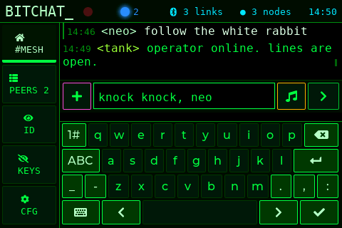 keyboard | tap the input field; ✓ sends |
| 04 | 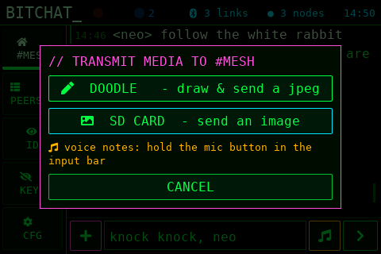 attach menu | `+` in the input bar |
| 05 | 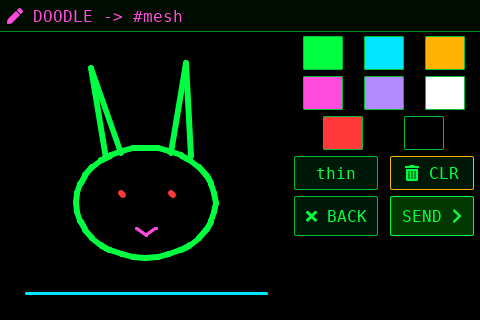 doodle pad | attach → DOODLE, draws and sends a JPEG |
| 06 | 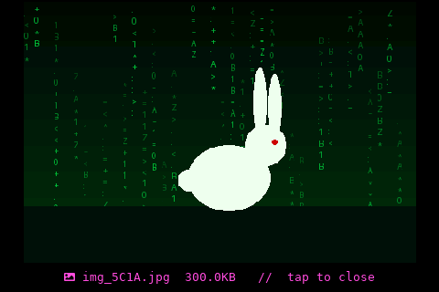 image viewer | tap an image thumbnail |
| 07 | 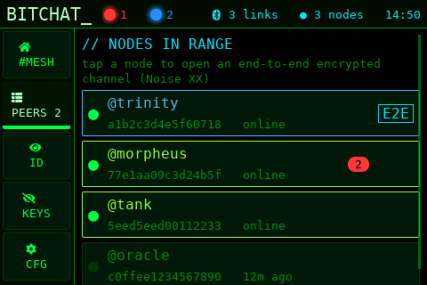 peers | sidebar PEERS; red badge = unread, `E2E` = Noise session |
| 08 | 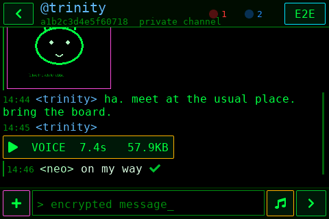 private chat | tap a node; ✓ sent, ✓✓ delivered, 👁 read |
| 09 | 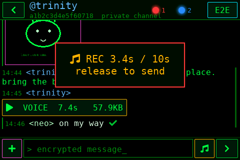 voice recording | hold the mic button (needs an I2S mic) |
| 10 | 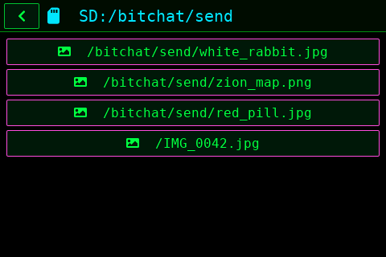 SD image picker | attach → SD CARD |
| 11 | 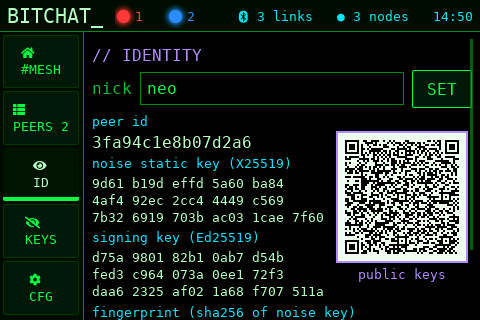 identity | sidebar ID: nick, peer id, public keys + QR |
| 12 | 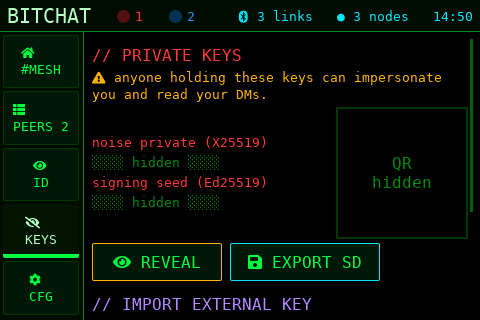 private keys (hidden) | sidebar KEYS |
| 13 | 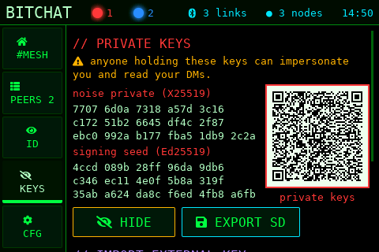 private keys (revealed) | KEYS → REVEAL: hex + QR |
| 14 | 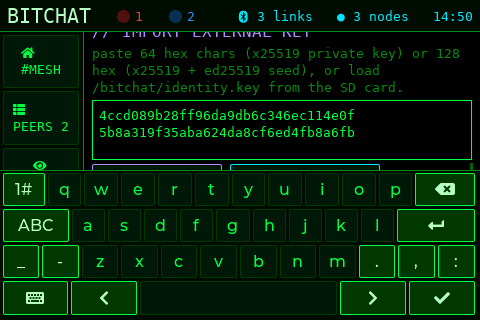 key import | KEYS → paste hex / LOAD SD → confirm |
| 15 | 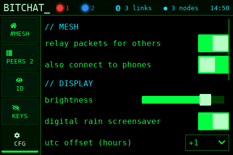 settings | sidebar CFG |
| 16 | 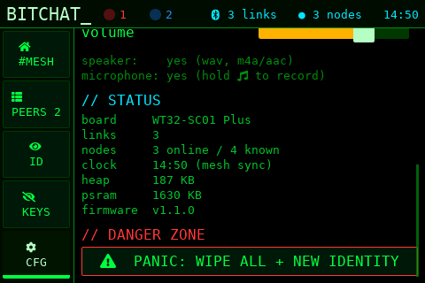 settings (bottom) | scroll CFG |
| 17 | 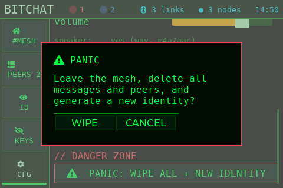 panic | CFG → PANIC |
| 18 | 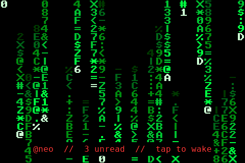 screensaver | 2 min idle; tap to wake |

Virtual LEDs next to the title (and in the DM header) blink while there are unread messages:
**red** = unread on the public #mesh channel, **blue** = unread private messages. The number is the count.
